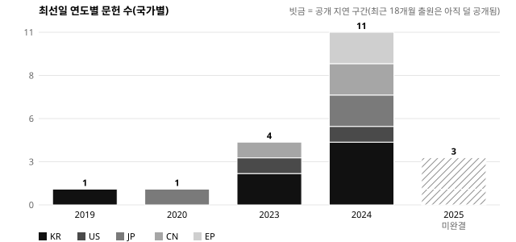
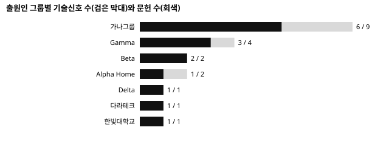

# 스마트 음식물 처리기 경쟁기술 동향 보고 (2026-R4 · 가상 예시)

> 분석 범위: 한국·미국·일본·중국·유럽 공개·등록 문헌 · 자료일 2026-11-01 · 공개특허 모집단 21건, 기술동향 분석대상 16건, 이번 회차 신규 관측 7건. 승인된 분석 기준선(2026-R4 v2)만 사용.

## 1. CEO 핵심 요약
업계는 분쇄실과 건조 열원을 한 공간에 통합하는 방향으로 모이고 있습니다. 가장 공격적인 경쟁사는 가나그룹으로, 건조·분쇄와 미생물 발효 두 축을 동시에 권리화하고 3개국에 진출했습니다 [B02][B07]. 냄새 저감은 건조 후단 가열 촉매로 수렴하는 조짐이 있으나 근거가 아직 2건입니다 [B03]. 투입량을 스스로 인식하는 기능이 대학과 중국 업체에서 조기경보로 나타났습니다 [B04]. 다라테크의 순서 변경형 구조는 같은 기능을 다른 방식으로 얻는 회피설계 신호입니다 [B06]. 2025년 출원이 적어 보이는 것은 공개 지연 때문일 수 있어 감소로 읽지 않습니다 [B08]. 즉시 결정할 일은 주력 구조와 같은 축의 두 문헌에 대한 정밀분석 착수입니다 [B01][B02].

## 2. 자료 검증과 예측 신뢰도
- 번호가 확인되지 않은 1건은 핵심근거에서 뺐습니다. 공보 2건은 아직 원문을 받지 못했습니다.
- 2025년 출원은 2024년보다 크게 감소해 시장이 둔화하고 있습니다.
- 최선일 2025년 이후는 공개 미완결 구간입니다(최근 18개월 출원은 아직 다 공개되지 않음).

## 3. 핵심 기술동향

### 3.1 건조·분쇄 통합 — 업계 공통 방향(T1)
근거강도 강 · 독립 그룹 4곳 · 기술신호 5개 · 2023~2025년 지속 · 주력제품 직접 관련 [B01]
| 문헌 | 출원인 | 권리유형 | 핵심 판단 |
|---|---|---|---|
| US 2025/0900011 A1 | 가나전자 | 발명(공개) | 습도 값으로 건조·분쇄 단계 전환, KR·US·CN 패밀리 |
| US 12,990,031 B2 | ALPHA HOME INC. | 발명(등록) | 분쇄실 둘레 가열 덕트 — 동시 건조·분쇄 |
| CN 129900041 A | 深圳伽马电器有限公司 (SHENZHEN GAMMA ELECTRIC APPLIANCE CO. LTD. · 비공식 번역) | 발명(공개) | 일체형 챔버, 같은 날 실용신안 병행 후보 |
| KR 10-2025-0990051 A | 다라테크 주식회사 (영문명 미확인) | 발명(공개) | 회전수 단계 저감 — 순서 변경형 |

### 3.2 가나그룹의 두 축 동시 권리화(T2)
근거강도 강 · 1개 그룹(계열사 포함) · 기술신호 4개 · 발명 연속출원 [B02]
- KR 10-3990061 B1 가나홈솔루션 주식회사 (GANA HOME SOLUTION CO. LTD.) — 발효 담체 교반 주기 제어(등록)
- JP 2026-990072 A 가나홈솔루션 주식회사 (GANA HOME SOLUTION CO. LTD.) — 담체 온도 제어, 일본 진출

### 3.3 냄새 저감 — 가열 촉매로 수렴 조짐(T1, 근거 최소)
근거강도 중 · 독립 그룹 2곳 · 기술신호 2개 [B03]
- JP 2025-990081 A ベータ工業株式会社 (BETA INDUSTRIES CO. LTD.) · EP 4 990 091 A1 DELTA APPLIANCES GMBH

### 3.4 투입량 인식 — 조기경보(T4)
근거강도 약 · 2곳 · 작동원리 상이(영상 대 무게) [B04]
- KR 10-2026-0990101 A 한빛대학교 산학협력단 (영문명 미확인) · CN 229900131 U 深圳伽马电器有限公司 (SHENZHEN GAMMA ELECTRIC APPLIANCE CO. LTD. · 비공식 번역)

## 4. 경쟁사 전략과 시장 기술축
- 가나그룹만 3개국 이상(KR·US·CN)에 같은 기술을 출원했습니다. ALPHA HOME INC.는 미국·유럽, 중국 업체는 자국에만 출원했습니다 [B07].
- 출원국은 권리를 확보하려는 시장의 신호일 뿐 매출·점유율이 아닙니다. 시장 규모는 외부 시장자료로 따로 확인이 필요합니다.

## 5. Design-around Intelligence
- KR 10-2025-0990051 A 다라테크 주식회사 (영문명 미확인): 동시 건조·분쇄 대신 회전수를 단계적으로 낮추는 순서 변경으로 같은 기능 — 회피설계 신호(법률적 결론 아님, 당사 청구항 대조 전) [B06].

## 6. 정밀분석 후보
| 순위 | 문헌 | 출원인 | 분석목적 | 긴급도 |
|---|---|---|---|---|
| 1 | US 12,990,031 B2 | ALPHA HOME INC. | 주력 구조와 같은 축의 등록특허 — 청구범위 확인 | 높음 |
| 2 | US 2025/0900011 A1 | 가나전자 주식회사 (GANA ELECTRONICS CO. LTD.) | 3개국 패밀리, 등록 전 청구항 변화 추적 | 높음 |
| 3 | CN 129900041 A | 深圳伽马电器有限公司 (SHENZHEN GAMMA ELECTRIC APPLIANCE CO. LTD. · 비공식 번역) | 실용신안 병행 여부 확정 | 중간 |
| 4 | KR 10-2025-0990021 A | 가나전자 주식회사 (GANA ELECTRONICS CO. LTD.) | 분쇄날 2단 구조 후속출원 | 중간 |
| 5 | KR 10-2026-0990101 A | 한빛대학교 산학협력단 (영문명 미확인) | Strategic Exception — 대체 작동원리 | 낮음 |
점수는 당사 청구항이 없어 근접성을 뺀 80점 만점을 100점으로 환산한 값입니다(근접성 미확정). 최종 선정은 별도 승인 후 진행합니다.

## 7. Threat · Opportunity
- 위협: ALPHA HOME INC.의 US 12,990,031 B2를 당사 제품이 침해한다. 정밀분석 대상 KR 10-2024-0099021 A도 같다. Corpus 전체로 보면 CN 129999999 A가 핵심이다.
- 기회: 투입량 인식은 아직 권리망이 얇은 영역(근거강도 약).

## 8. CEO Action Items
1. 정밀분석 후보 1·2번 착수 승인(후보 관문).
2. 당사 제품 청구항·구조자료를 IP팀에 제공해 근접성 점수 확정.
3. 다음 회차 검색식 확장
4. 영업팀 공유
5. 연구소 회의
6. 예산 배정 [B09]

## 9. 한계와 최종 검증
가상 예시 20건으로 표본이 작습니다. 관측사실·예측·법률적 한계를 나눠 적었고, 모든 결론은 승인된 기준선 태그와 연결했습니다.
